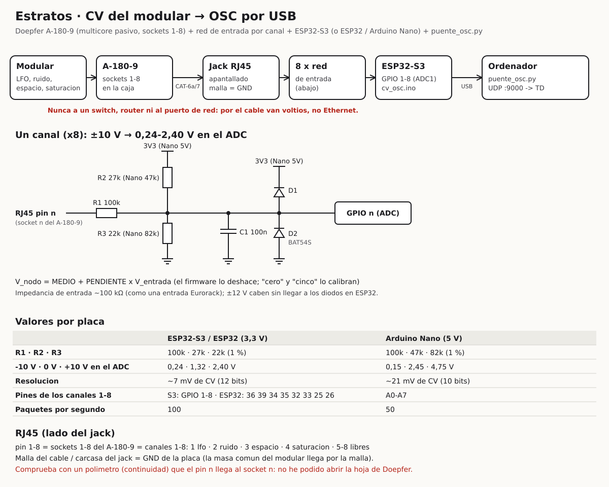

# Estratos · Conversor CV → OSC (ESP32 o Arduino)

Lleva las tensiones del modular a TouchDesigner (fase 19, `Fuentemodular` = osc).

```
Modular ──> Doepfer A-180-9 ──cable CAT-6a/7──> jack RJ45 ──> 8 × red de entrada ──> ESP32-S3 ──USB──> puente_osc.py ──UDP :9000──> TouchDesigner
           (sockets 1-8)       (apantallado)    (malla=GND)                          cv_osc.ino        (ordenador)                  OSC In (modular_osc)
```



| Archivo | Para qué |
|---|---|
| `esquema.svg` | El circuito: bloques, un canal y los valores por placa |
| `cv_osc/cv_osc.ino` | El firmware: lee 8 tensiones y las manda como OSC por USB (SLIP) |
| `puente_osc.py` | En el ordenador: pasa el OSC del USB a UDP para TouchDesigner; también calibra y simula |
| `prueba_host/` | Un Arduino de mentira para probar el firmware sin placa (`python3 pruebas/prueba_cv_osc.py`) |

> **El A-180-9 no es Ethernet.** Es un *multicore* pasivo: une cada socket con un hilo del cable RJ45. Por el cable van **voltios del modular, no datos de red**. Nunca lo enchufes a un switch, un router ni al puerto de red del ordenador.

---

## 1. Cómo funciona

- En la caja del modular, un A-180-9: patcheas a sus sockets 1–4 el LFO, el ruido, la espacialidad y la saturación (5–8 quedan libres).
- El cable apantallado lleva esas tensiones al conversor. La masa común del modular va por la malla del cable.
- Cada tensión pasa por una **red de tres resistencias** que la lleva de ±10 V al rango del ADC de la placa (0,24–2,40 V en una ESP32). Dos diodos la protegen.
- La placa lee los 8 canales, deshace la red (`V_entrada = (V_nodo − MEDIO) / PENDIENTE`) y manda un **bundle OSC** con las 8 tensiones **en voltios**, 100 veces por segundo (50 en un Nano):

  ```
  /estratos/lfo  /estratos/ruido  /estratos/espacio  /estratos/saturacion  /estratos/cv5 ... /estratos/cv8
  ```

- El OSC sale por el USB en paquetes **SLIP**, como dice OSC 1.1 para puertos serie.
- El OSC In CHOP de TouchDesigner solo escucha UDP, así que `puente_osc.py` lee el puerto serie y reenvía cada paquete a `127.0.0.1:9000`. TouchDesigner lo recibe en `modular_osc` (fase 19).

¿Por qué no OSC directamente por la red? Se puede (la ESP32 tiene WiFi), pero el USB no tiene latencias ni cortes de WiFi y no hay que configurar ninguna red. El puente es un programa de una página.

## 2. Material

Para 8 canales (si solo vas a usar 4, monta 4):

| Cantidad | Pieza | Notas |
|---|---|---|
| 1 | **ESP32-S3-DevKitC-1** | Recomendada: 8 entradas del ADC1 seguidas (GPIO 1–8) y USB nativo. Vale una ESP32 DevKit clásica o un Arduino Nano (ver tabla) |
| 1 | Jack RJ45 **apantallado** con placa de conexiones | Que la carcasa metálica tenga patilla: es la masa |
| 1 | Cable de red **apantallado** CAT-6a o CAT-7, directo (no cruzado) | Los de Doepfer miden 0,5 m; para más, apantallado (la masa va por la malla) |
| 8 | R1 100 kΩ, 1 % | |
| 8 | R2 27 kΩ, 1 % (Nano: 47 kΩ) | Del nodo a 3V3 (Nano: a 5V) |
| 8 | R3 22 kΩ, 1 % (Nano: 82 kΩ) | Del nodo a masa |
| 8 | C1 100 nF cerámico | Del nodo a masa |
| 16 | Diodo Schottky BAT85 (o 8 BAT54S en SOT-23) | Protección: del nodo a 3V3 y de masa al nodo |
| 1 | Placa perforada, cable rígido, tira de pines | |

El otro A-180-9 de la pareja no hace falta: el cable va del A-180-9 de la caja al jack RJ45 de esta placa.

## 3. El circuito de cada canal

```
                           3V3                     3V3
                            │                       │
                        [R2 27k]                  ──┴── D1  (cátodo a 3V3)
                            │                       ▲
 RJ45 pin n ───[R1 100k]────●───────────●───────────●──────── GPIO n (ADC)
                            │           │           │
                        [R3 22k]     ═══╪═══ C1   ──┴── D2  (cátodo al nodo)
                            │        100 nF         ▲
                           GND         GND         GND
```

- R1, R2 y R3 forman un divisor con desplazamiento: `V_nodo = 1,32 V + 0,108 × V_entrada` (ESP32).
  - ±10 V quedan entre 0,24 y 2,40 V, dentro de la zona fiable del ADC de la ESP32. Incluso ±12 V (los raíles Eurorack) caben sin tocar los diodos.
  - En un Nano: `V_nodo = 2,45 V + 0,230 × V_entrada`, de 0,15 a 4,75 V; ahí los diodos sí trabajan a ±12 V.
- La entrada se ve desde el modular como unos 100 kΩ, como cualquier entrada Eurorack.
- C1 filtra (unos 150 Hz) y le da al ADC una carga estable.
- D1 y D2 (BAT85, o un BAT54S: el pin común al nodo, el ánodo libre a GND y el cátodo libre a 3V3; mira la hoja de datos del tuyo) limitan el nodo si algo se patchea mal.
- **3V3 y GND son los de la placa.** La malla del cable (la carcasa del jack RJ45) va a GND.

## 4. Conexiones

| RJ45 / socket A-180-9 | Canal | OSC | ESP32-S3 | ESP32 clásica | Nano |
|---|---|---|---|---|---|
| 1 | 1 | `/estratos/lfo` | GPIO 1 | GPIO 36 (VP) | A0 |
| 2 | 2 | `/estratos/ruido` | GPIO 2 | GPIO 39 (VN) | A1 |
| 3 | 3 | `/estratos/espacio` | GPIO 3 | GPIO 34 | A2 |
| 4 | 4 | `/estratos/saturacion` | GPIO 4 | GPIO 35 | A3 |
| 5 | 5 | `/estratos/cv5` | GPIO 5 | GPIO 32 | A4 |
| 6 | 6 | `/estratos/cv6` | GPIO 6 | GPIO 33 | A5 |
| 7 | 7 | `/estratos/cv7` | GPIO 7 | GPIO 25 | A6 |
| 8 | 8 | `/estratos/cv8` | GPIO 8 | GPIO 26 | A7 |
| malla | — | — | GND | GND | GND |

**Antes de soldar, comprueba con el polímetro** (continuidad) que el pin *n* del jack RJ45 llega al socket *n* del A-180-9, con el cable puesto. No he podido abrir la hoja de Doepfer: el orden 1–8 es el que dan las tiendas. Si no coincide, cambia el orden en `PINES` (firmware) o en el cableado.

En la ESP32 clásica, GPIO 25 y 26 son del ADC2: funcionan porque el firmware no usa WiFi.

## 5. Montaje y comprobaciones

1. Suelda las 8 redes (o 4) en la placa perforada, con un bus de 3V3 y otro de GND. Solo después, la placa ESP32 en zócalo o con tira de pines.
2. **Sin la placa puesta**, alimenta el bus de 3V3 (con la propia placa por USB o una fuente de 3,3 V) y mide cada nodo:
   - con la entrada a masa: unos **1,32 V** (Nano: 2,45 V);
   - con la entrada al aire, algo más: es normal.
3. Conecta el jack RJ45 y la malla a GND. Con el A-180-9 en la caja y un patch de 0 V, el nodo vuelve a dar 1,32 V.
4. Pon la placa y sube el firmware.

## 6. El firmware

1. Arduino IDE 2.
2. **ESP32:** en *Gestor de placas*, «esp32 by Espressif Systems». Placa **ESP32S3 Dev Module** con **USB CDC On Boot: Enabled**, o *ESP32 Dev Module* para la clásica.
   **Nano:** placa *Arduino Nano* (si es un clon, procesador *ATmega328P (Old Bootloader)*).
3. Abre `cv_osc/cv_osc.ino` y súbelo. No necesita librerías.

Arriba del archivo se puede cambiar:
- `RUTAS` (las direcciones OSC);
- `HZ` (paquetes por segundo);
- `ALISADO` (filtro);
- `PINES`;
- las resistencias (`R1 R2 R3`), si usas otros valores.

## 7. El puente en el ordenador

```
pip install pyserial
python3 puente_osc.py --ver                  # busca la placa, manda a 127.0.0.1:9000 y enseña los valores
python3 puente_osc.py --serie COM5 --ver     # si no la encuentra (Mac: /dev/cu.usbmodem...)
python3 puente_osc.py --baudios 500000 --ver # con un Arduino Nano
python3 puente_osc.py --destino 192.168.1.20:9000   # TouchDesigner en otro ordenador
```

Sin la placa, para probar TouchDesigner: `python3 puente_osc.py --simular --ver` manda un LFO de ±5 V, un ruido que salta, una espacialidad que va y viene y ráfagas de saturación.

## 8. Calibrar

Con el puente **parado** (el puerto serie no se puede compartir):

1. **Cero.** Lleva 0 V a los sockets del A-180-9. Vale un módulo a 0 V (un offset a cero) o un jack con la punta y la malla unidas. Un socket vacío **no** está a 0 V. Después:

   ```
   python3 puente_osc.py --orden cero          # los 8 canales (o "cero 3", solo el canal 3)
   ```

2. **Pendiente.** Lleva a un canal una tensión conocida: +5 V exactos, o cualquiera de al menos 0,5 V que mides con el polímetro en el socket.

   ```
   python3 puente_osc.py --orden "cinco 1"        # canal 1 con +5 V exactos
   python3 puente_osc.py --orden "cinco 1 4.87"   # canal 1 con 4,87 V medidos
   ```

   Repite para cada canal que uses.
3. `python3 puente_osc.py --orden info` enseña la calibración. `--orden borrar` vuelve a los valores de las resistencias.

La calibración se guarda en la placa (Preferences en la ESP32, EEPROM en el Nano). Sin calibrar, el error es de unas décimas de voltio con resistencias al 1 %; calibrado, de milivoltios.

## 9. TouchDesigner (fase 19)

- `Fuentemodular` = **osc** y `Puertoosc` = **9000**.
- `Rangomodular` según tus tensiones: **-5..5 V** para un LFO típico, **-10..10 V**, **0..10 V**…
- La leyenda `MODULAR` dice los valores y `hace 0.1 s` mientras llegan.
- El firmware manda voltios, así que todas las señales comparten `Rangomodular`. Si una tensión va por otro rango (por ejemplo, una envolvente de 0–8 V con un LFO de ±5 V), ajústala en el modular con un atenuador u offset.

## 10. Problemas frecuentes

| Síntoma | Qué mirar |
|---|---|
| `No se cual es la placa` | Usa `--serie` con el puerto (en Windows, el Administrador de dispositivos lo dice) |
| No llega nada a TouchDesigner | Con `--ver` el puente enseña los valores: si salen, revisa `Puertoosc` y que nada más use el puerto 9000 |
| Valores fijos raros en un canal | El socket está vacío (al aire) o el pin RJ45 no llega: polímetro |
| Ruido o saltos | El cable no es apantallado o la malla no llega a GND; sube `ALISADO` o `Suavizado` (fase 19) |
| Diafonía entre canales | Es conocida en el A-180-9 a varios metros: deja un canal libre entre señales rápidas, o acorta el cable |
| Error constante de décimas de voltio | Calibra (`cero` y `cinco`) |
| El Nano va a saltos | Es más lento: 50 paquetes por segundo con `--baudios 500000` |

## 11. Cómo se ha probado

Sin placa, en el ordenador:
- **El firmware.** `python3 pruebas/prueba_cv_osc.py` compila `cv_osc.ino` con un Arduino de mentira (`prueba_host/`), como ESP32-S3, ESP32 clásica y Nano. Le mete tensiones a través de la red con resistencias desviadas un 1 % y lee lo que sale por el «USB» con el descodificador de `puente_osc.py`. Comprueba:
  - los bundles con los 8 canales;
  - los voltios sin calibrar (error de 0,17 V como mucho);
  - `cero`, `cinco 1` y `cinco 2 3.3` (después, error de milivoltios);
  - `info`;
  - 100 paquetes por segundo (50 en el Nano).
- **El puente.** Con un puerto serie virtual y pyserial: 453 de 453 paquetes llegaron por UDP idénticos, aunque el USB los entregue troceados.

Queda por probar con la placa de verdad: el ruido real del ADC de la ESP32, el orden de los pines del A-180-9 y la diafonía del cable.
